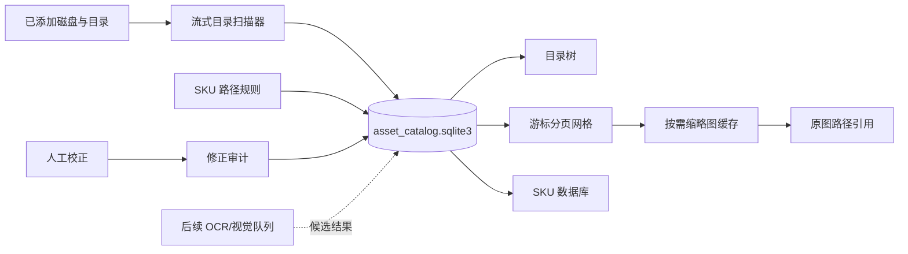

# LR 式资产归档与 SKU 索引

[CODEX_LONG_TASK_CONTINUE_V3]

- 当前状态：已完成隔离演示；源码服务运行于 `http://127.0.0.1:8775/`，数据目录为 `build/asset-catalog-demo-data`。
- 下一步：用户确认交互与数据模型后，再接入真实 OCR/视觉解析队列与正式发行构建。
- TODO：无本轮实现遗留。
- 最近验证：`test_asset_catalog.py`、`test_asset_catalog_browser.py`、`test_asset_archive.py` 共 20 项通过；更新后的既有 `test_asset_browser.py` 集成场景通过。
- branch/commit：`codex/automatic-update-installer`，开始时存在用户已有未提交改动，保持不覆盖。
- 阻塞：无。初版仅以文件名与路径按既有 SKU 规则解析，不调用外部模型；无法从路径判定的文件进入待复核队列。

## 目标

将“资产归档”重构为不含左上导航预览的 LR 式三栏工作区：左侧按磁盘和已添加文件夹显示可展开目录；中间显示引用图片的网格预览；右侧显示自动 SKU 解析、检索和当前图片 SKU 元数据编辑。

新增 SKU 数据库页，按 SKU 汇聚已扫描照片。扫描只建立路径引用和索引元数据，不复制、不移动原图；人工修正后的 SKU 作为最终元数据写入索引，并可选调用既有文件元数据写入链路。

## 验收标准

- 可添加/展开目录，选择目录后展示其图片，图片保持源路径引用。
- 可点击“自动解析 SKU”扫描目录中的图片，生成可搜索 SKU 指纹和待复核项。
- 可按 SKU 搜索所有被索引图片，并在 SKU 数据库页按款号查看照片。
- 右侧可编辑当前图片 SKU，保存后即刻更新检索与 SKU 数据库。
- 以临时图片和临时 SQLite 数据验证，不修改用户原片。

## 百万级架构

- **扫描层**：使用 `os.scandir` 深度优先流式遍历，不构建全量路径列表；每 1000 条使用一次 SQLite 批量写事务。根目录有单调 `scan_epoch`，扫描结束后由 SQL 把旧代次标为离线，避免百万级 `seen` 集合和超长 `IN` 查询。
- **索引层**：媒体二进制不入库。`items` 保存规范路径、相对目录、尺寸/修改时间、文件指纹、SKU 规范键、来源和人工修正；`corrections` 保留审核轨迹。SQLite WAL 让网格读取不被扫描写入阻塞。
- **查询层**：`(root, online, modified DESC, id)` 服务目录浏览，`(normalized, online, modified DESC, id)` 服务 SKU 检索；接口返回稳定游标，可在前端替代深页 offset，避免百万级深翻页线性跳过。
- **媒体层**：网格只获取当前页缩略图。缩略图按 `文件指纹 + 尺寸` 缓存，源文件始终通过路径引用，删除缓存可完全再生。
- **解析层**：本轮路径规则直接写入低置信候选；后续 OCR 或视觉模型作为独立队列写入候选结果，人工 `manual` 结果优先级最高，不会被重扫或自动任务覆盖。

## 本轮实现与验证

- `asset_catalog.sqlite3` 与既有拍摄库、SKU 对账库分离；扫描结果只保存路径、文件属性、哈希指纹和 SKU 索引，不复制或移动图片。
- 资产归档页改为按盘符分组、逐级展开的目录树、图片网格和右侧元数据三栏。图片通过受控本机预览接口按需生成缩略图；右侧人工确认会更新 SKU 指纹并写入修正审计表。
- 新增 SKU 数据库页，按规范化 SKU 聚合照片引用。检索、目录切换、翻页和 SKU 查看均从独立索引读取。
- 自动解析使用现有 `extract_codes` 与 `normalize` 规则扫描文件名和最近目录层级；日期和常见拍摄序号被排除，多个候选归为待复核。该阶段没有调用外部 OCR 或视觉模型。
- `test_asset_catalog.py` 覆盖重扫保护、人工修正、分组和缓存；`test_asset_catalog_browser.py` 覆盖归档页和 SKU 数据库的真实浏览器操作；`test_asset_archive.py` 17 项全部通过；既有浏览器集成场景已改用新归档界面并通过。

## 2026-10-21 SKU 导航页高度修复

- 用户截图中的 SKU 数据库页高度收缩、底部导航停在页面中部，原因是工作区填充样式只枚举了归档、解析和设置三个 ID，漏掉新 SKU 页。
- 统一由工作台下的 `.asset-workspace` 使用剩余高度，保持底部导航贴底；空列表提示跨满网格列，避免挤在左侧单个缩略图位置。不更改索引、SKU 归属或原照片。
- 修复前真实浏览器在 1440×900 下复现：SKU 面板仅 297.875px、导航底边 428.875px；修复后打包引擎相同视口面板 769px、导航底边 900px，样式与源码 SHA-256 一致，无页面错误或横向溢出，截图已打开检查。
- SKU 空列表/有数据浏览器测试通过，覆盖四主题和三组桌面尺寸；底部导航测试从旧五页签更新为实际六页签，补齐隔离 CATALOG 服务，四主题 × 六组尺寸 × 六页签共 144 组布局/切页检查通过。结果在 `build/sku-database-layout/` 和 `build/bottom-tabs/result.json`。
- 样式已同步普通发行版、内置模型版和引擎构建目录；无需重建 Python 引擎。普通发行目录中的演示进程保持运行；发行验收使用单独引擎和隔离库。提交见 `fix: fill SKU database workspace and anchor bottom navigation`。

## 2026-10-21 资产管理页右侧空白修复

- 复现：1680px 窗口内资产归档页被旧弹窗 ID 样式限制为 1120px，内部三栏仅 1080px，右侧空白 560px。上一次统一工作区选择器时降低了选择器优先级，旧 ID 规则重新生效。
- 修复：保留通用工作区规则，并对遗留的归档、解析页面 ID 补充足够优先级的覆盖，确保 width=100%、max-width=none。右侧 SKU 元数据栏贴合内容区右边缘，SKU 数据库页的高度修复继续保留。
- 验证：新增宽度回归先复现 1120≠1680，再通过四主题 × 1680/1000/1920 三种桌面尺寸的页面宽度、右栏位置和溢出检查；已有 SKU 数据库检查和 144 组底部导航回归通过。截图 `build/archive-width/archive.png` 已打开检查。
- 部署：样式同步普通版、内置模型版及引擎构建目录；发行引擎隔离库实际验证 width=1680、页面 width=1680、右栏边缘=1659、底部导航=1050，解析页也全宽，CSS 哈希与源码一致，无页面错误。结果在 `build/archive-width/deployed-result.json`。
- 本轮仅修复样式和增加布局验证，未修改索引或用户照片。提交见 `fix: remove legacy dialog width limits from asset workspaces`。
