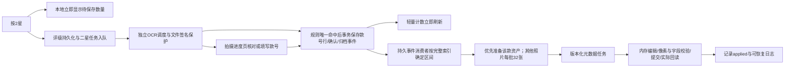

# 全部4217张与56款真实全链路性能实战

[CODEX_LONG_TASK_CONTINUE_V3]

- 当前状态：2026-11-05 已全部完成本轮合并和安装更新；主工作区已合入 `24e9d3d`，`D:/Program Files/Framekeep` 及项目 `dist/末帧选片` 已更新，正式桌面和引擎保持运行。
- 下一步：使用原桌面／开始菜单入口；如需继续处理后台状态轮询超时，按 `final-health.json` 和已有相关任务独立定位。
- TODO：本轮合并与本机安装无遗留；后台状态接口超时作为既有独立问题保留。
- 最近验证：本轮源码86通过/2 RAW缺样本跳过，恢复专项6通过，冻结32通过；118模块、入口、71资源与Perl一致。836安装文件哈希通过，60325资料文件清单及全部根目录SQLite/WAL/SHM启动前哈希不变；配置和登记保留；实际原生文字树、SKU图片与历史文档页面通过。此前4217张/56款完整实战结果保留在下文。
- branch/commit：主工作区 `chore/integrate-task182-local`；合入实现 `24e9d3d`（基线 `ef639ea`），原隔离分支 `perf/twenty-sku-field-trial` 保留。2026-11-05 当日同步标记已存在，本次仅本地提交。
- 阻塞：无。用户已授权合并和本机程序更新；不发布线上更新，保留生产资料、模型与原素材。

## 目标与验收

1. 使用真实安装程序和已配置模型，全部56个款末标签按二星后立即出现待解析数量，不能将待解析冒充已入库。
2. OCR合规结果自动入库，异常候选可在拍摄进度处理，数据库确认不等待文件写入。
3. 完整区间每张图写入正确SKU及属性，保留像素和非目标字段，检查边界与重复款。
4. 报告启动、按键反馈、OCR排队/执行、入库、区间准备、逐款元数据完成耗时，缺失项明确标注。
5. 强制终止进程后文档、已确认及在途任务可恢复；模拟进程中断不等同物理磁盘损坏测试。
6. 提供可操作隔离演示，测试全部通过再请求用户验收，未经通过不合并。

## 初步架构风险（待实测验证）

- `AssetArchive.sync_stream` 首次为全目录逐张 `ensure`，每张包括哈希、ExifTool和SQLite往返；`start_stream`先同步旧流再同步新流，归档接续可能被全目录准备阻塞。
- `SkuService._parallel_labels_enabled`仅外部模型启用独立调度；本地模型是否被区间准备挡住需验证。
- 标星保存链路先做共享评级写回登记，再排OCR；长锁和全目录读取可能放大请求延迟。
- 进度目前主要依赖已识别SKU，无法在模型返回之前显示真实待解析款数；必须区分“已收尾/解析中/已入库/写回中”。
- 多个数据库通过持久事件接续，需要检查中断重放的幂等性、跨库提交空窗和失败可见性。

## 优化方向

保留现有SQLite WAL、评级与元数据保护机制，按实测收敛改动：按键先持久化评级与标签意图，独立OCR消费者，事务保存识别结果与接续事件，区间归档消费者按有效边界处理，元数据消费者校验后原子提交并回读；进度读模型分别呈现上述状态。不能通过跳过校验或预填SKU来缩短时间。

## 样本与证据

源：`\\192.168.0.181\新摄影\细节图\源图片备份（勿动）\现场拍摄小档\2026-11-04`。选取名称排序前20个XMP，从目录首张到第20个标签的完整JPG区间；原XMP只作为离线预期对照，不送入模型或预填业务库。所有写入在测试副本进行，源文件哈希留存并复核。证据置于隔离工作树`build/field-trial/`。

用户后续明确改为全部素材：4217张、56个区间，无末尾未封口图片。前20款1427张仅保留作安装版基线。

## 本轮实测与中间问题

- `baseline/`：真实安装EXE 20261104110836，原生首屏2.771秒。WebView2未开放CDP，原生窗口由computer-use检查；批量按键使用同一真实安装引擎提供的页面，不能声称56次都由原生输入工具完成。
- 20款基线识别结果19自动确认，1张原文`L<787035-P2109`未满足LC规则进入复核，不能计作丢失。归档先逐张ensure整目录，元数据起初为0；约14–60秒入库。10分钟采样中脚本SQLite读取遇到3秒锁等待失败，已延长采样等待；不把脚本失败作为产品通过。
- 原生基线窗口核验19已拍摄且后台队列仍在写。保存队列快照后关闭本次隔离程序，没有操作生产data。
- 12张元数据剖析5.89秒，其中每张内存结果回读仍新启ExifTool进程，共约2.4秒。新增常驻只读模式，保持全部写前/写后/像素/缩略图保护。
- 常驻读取初版对Canon同名字段优先级及XMP列表不同；已按ExifTool CLI优先级/列表规则修复，并对全量目录均匀抽21张验证摄影字段一致。System文件属性因内存输入天然不同，原有校验已经排除System字段，未新增放松。
- `full/`第一轮4217张因脚本调用browsePhoto没有等待分页，只标记了前三个目标及一张错误目标；记录已保存`paging-harness-failed.json`。第二次验证发现残留错误边界后主动停止，必须重置隔离业务库和副本评级后再做有效全量验收。脚本已改为await FramekeepPaging.goto并验证remoteTarget ID。
- 代码已加入独立轻量`/api/sku/feedback`与本地按键“待保存/待解析/待复核/已入库”反馈；单图读取改为按ID查找；二星ocr_details不再展开整个目录区间；元数据有积压时不再每张固定休眠100ms。尚待完整回归与冻结/演示验证。

## 恢复入口

- `tools/field_trial.py`：prepare/run，`--all`全量，`--source`源码，`--attach URL`连接本机隔离桌面引擎；不要对源目录运行写操作。
- `tools/start_field_demo.py build/field-trial/full/data`：用安装外壳启动隔离源码与资料。实际URL/PID写入`desktop-launch.json`；若启动路径变更必须同步工作树下APP_ROOT，ExifTool仍复用已安装runtime。
- `tools/field_engine.py`：真实产品入口的可观测包装，记录ensure/sync_stream/process_one/真实模型调用耗时；没有提供OCR答案。
- 当前无提交、无合并、无push；原工作区036/143、SDK、错误目录原改动未触碰。

## 最终隔离环境与架构

- NAS素材副本：`\\192.168.0.181\新摄影\细节图\末帧隔离实战-20261105-4f337c9a`，位于“源图片备份（勿动）”之外；4217张复制时逐张匹配原件初始SHA。原件及56份原XMP只读。
- 最终本机资料：`G:/app/LR-field-trial/build/field-trial/nas-final/data`，SQLite/WAL与生产data隔离。模型配置仅复制已安装配置，凭据不输出或提交；实际选用本机GLM-OCR接口，未自动追加Qwen。
- `.runtime`为指向原工作树运行库的只读使用junction；构建输出、源码修改与资料均在隔离树。`backup/v029`、`v030`保留高风险修改前必要源码。
- 最终引擎：`build/engine-dist/framekeep-engine/framekeep-engine.exe`；使用`tools/start_field_demo.py build/field-trial/nas-final/data --frozen`，已安装桌面外壳不被覆盖。`desktop-launch.json`记录PID、URL与源码摘要；不要在该引擎运行时覆盖构建目录。
- `FRAMEKEEP_TRACE_PIPELINE=1`仅验收开启，记录OCR阶段、确认及文件完成时刻，不记录凭据、图片正文或OCR文本。正常用户默认关闭；计时失败不影响业务事务。

### 已证实的阻塞与处理

1. 共享评级原本逐图执行多轮SQL；改为批量查询与按评级版本失效的小缓存，保留显式零星、配对及已验证跨目录关联。
2. 选片保存触发反复abort/reload，客户端取消不停止后端计算；清单和标签刷新改为同类请求合并，独立反馈接口只查评级与相关标签。
3. 定时修复已确认区间持有SKU锁再等归档锁，实际元数据线程曾等待超过50秒；修复移出SKU锁，无缺失/旧字段升级时快速返回。
4. 归档事件批次持有全局归档锁；改为独立事件消费者锁，每个事件自己的事务/归档锁保护不变，文件提交可穿插。
5. 结果确认前同步重算整个历史清单；即时确认只事务更新本次证据与命中行，历史对账是可重建的读投影。
6. 自身写星改变签名，正确OCR可能被留在review且不再自动重试；自动确认的两次详情校验共用文件锁，不放松外部修改检查。
7. 原归档先准备完整4217张才投递首款；生产后台每轮最多32张，明确确认时优先准备该款完整区间。完整索引参与边界划分，未识别二星也隔断，乱序完成不串款。
8. 真正发行启动是延后启动后台线程，`autostart=False`不代表测试模式；预算同时检查实际线程状态，已加入针对该启动方式的回归。
9. 本次跨午夜实测发现自动确认读取当前文档会将旧任务写进新日期文档，造成重复流与重复写入；自动规则提交显式使用入队任务的project/scope。旧版本排队文件在新归属产生时立即取消，不再逐张等待过期任务被消费。
10. 每张内存结果回读新启ExifTool约0.2秒；扩展现有常驻Perl通道读取JPEG/XML，按CLI的列表与同名字段优先级输出，仍保留像素、缩略图、非目标字段、修订、哈希及回读保护。

### 已完成的真实流程与边界

- 本地全量运行曾完成56次实际标星，反馈中位数约5ms；拍摄进度页通过新“核对/填写款号”入口完成手写/误读修正，原始OCR文字保留。格式等价的点号/连字符应使用表格双击改款，避免重拍版本规则保留旧格式；最终验收脚本已走此真实路径。
- 真实强退前29份确认与文档，重启后全部保留、在途任务继续，两个业务库integrity_check均ok；证据`full/crash-recovery.json`。这是进程强退，不宣称实际切断电脑电源或磁盘损坏可恢复。
- NAS准备首轮整目录ExifTool超过180秒，属于夹具准备工具失败；后改为可恢复的独立批次。仅在校验原副本像素正确后清除该工具遗留的`*_exiftool_tmp`，未删除原件。
- 中间多轮用于定位问题，均保留`data-attempt-*`/`run-attempt-*`和线程栈；不作为最终通过数据。最终报告以nas-final有效完整一轮为准。
- 2026-11-05已做当日Git检查：隔离分支无上游且无本任务提交，未推送，公共Git目录同步日期已更新；当天后续仅本地commit。

## 最终结果与交付

- 最终运行构建：`build/engine-dist-final/framekeep-engine/framekeep-engine.exe`；没有覆盖`D:/Program Files/Framekeep`。最终单击入口为`build/field-trial/nas-final/启动隔离演示.cmd`，启动脚本核验已有实例的数据目录，避免误把正式实例当演示。
- 报告：`build/field-trial/nas-final/report.html`；总览`overview.png`、逐款图`per-sku.png`和56行数据`timings.json`。实际软件导出`全量拍摄记录.xlsx`，界面与Windows属性证据`demo-verification.json`。
- 首次工作台可操作2.749秒；强退后2.192秒。二星数量文本更新中位4.85ms、P95 5.8ms、最大6.5ms；这是即时反馈，不冒充已入库或已写文件。
- 每款模型执行累计中位0.433秒、P95 0.833秒。56标签共61次真实模型请求（含版本变化补跑），未注入SKU答案；本机GLM-OCR服务测试前已在运行，不代表内置模型冷加载。
- 主链路从标星到当前SKU全部写回44.51分钟，包含密集连续标星、NAS排队、人工核对、一次强退与引擎接续。首张文件7.734秒完成。逐款入库和写回时间见表，不将模型时间当作整款总耗时。
- 51项首次自动确认，5项待确认；逐张查看标签后共修正17项，包括已自动确认但手写误读/格式不完整的12项。修正均通过拍摄进度的核对按钮或表格改款完成，原始OCR文字保留。核对值依据标签可见文字，仍由用户在合并前作最终业务验收。
- 独立回读发现217张源素材的历史受管`SKU:`关键词残留。新增受管关键词规范化，普通关键词保留，字段级撤销可以恢复原值；旧已完成日志自动判断并仅补齐217张，实测100.04秒，未创建新的SKU归属或重复OCR。最终再次回读4217张，残留为0。
- 另外12张本地同素材微测5.892→2.957秒；NAS同12张成对副本每组前4张预热，后8张均值0.3267→0.3018秒。NAS对照时全量队列仍在工作，仅作现场观察，不宣称为带宽基准或全量同条件A/B。
- 强退时56份确认、文档和剩余队列已持久化；恢复后继续写回，三份SQLite完整性均`ok`。未物理切断电脑供电，不将进程强退等同磁盘损坏验证。
- 本批全为JPG，真实RAW内嵌用例缺样本跳过；RAW相关既有兼容逻辑保留。图像生成/AI答案预填均未参与。
- 原生窗口可访问性文本读到56已收尾/56已入库；系统截图与控件缓存不稳定，报表截图来自同一冻结引擎的实际工作台。可操作入口仍为原生桌面软件。
- 最终日志：`final-regression.log`、`frozen-sources-final.json`、`nas-final/verification.json`、`crash-recovery.json`、`keyword-repair-plan.json`与`data/pipeline-metrics.jsonl`。
- 补充发现的旧缓存竞态用例按当前“保留未知原文件并使用独立恢复槽”的契约修正断言，同时验证原件字节未变、未知文件未被索引接管；缓存实现未改。旧浏览器用例更新为现有拍摄类型输入框、等待接收完成及当前导出保存流程。

## 2026-11-05 主项目合并与本机安装更新

- 用户明确要求“将任务文档182的开发合并到主项目里，并更新到本地安装目录”，已替代此前等待合并授权的状态。
- 原主工作区基线 `ef639ea`，新建 `chore/integrate-task182-local` 后快进合入 `24e9d3d`，43 个文件，无冲突。原 036、143 文档及 SDK、错误目录的用户改动保留。
- 主工作区重新执行 `python -X utf8 选片助手/build_release.py --stage-only`，冻结引擎和 Cargo release 构建成功。118 业务模块、server 入口、71 份前端资源及 Perl helper 与源码一致。
- 源码专项实际执行 88 项：86 通过、2 项真实 RAW 缺样本跳过。首次命令另包含不存在的 `test_shooting_power_loss_recovery`，导致该命令整体失败；已纠正为实际 `test_shooting_recovery.ShootingRecoveryTests`，6 项通过。冻结专项 32 项通过，不把首次命令报为全通过，不重复声称已再跑 4217 张全量实战。
- 本轮证据目录：`build/task182-integration-20261105/`；汇总 `技术文档/验证记录/182-20261105主项目合并安装验收.json`。
- 安装事务 `D:/Program Files/Framekeep/.update-state/local-task182-20261105-085207` 已 complete。复用现有受管文件备份/journal/原子替换/注册流程，仅9份文件需要替换；836份受管文件哈希全部通过。全部根目录SQLite/WAL/SHM更新前后SHA-256、60325份资料文件清单在启动前一致；模型和目录监控配置哈希、安装标记及HKCU资料路径保持。没有迁移或合并隔离测试库。
- 正式桌面PID59456、引擎PID64692保持运行，ready=true、health busy=false；即时反馈8ms返回1已收尾/0已入库/1待解析，原生文字树一致。浏览器连接同一正式引擎，20款/1213条资料可读、当前72张图片、2份历史文档，实际可见图片解码和页面检查通过，脚本错误0、业务编辑0、无模拟响应。首张图片1.121秒、可见图片全部23.873秒，仅本轮现场观测。
- 原生窗口起初最小化，激活后工作台与原监控/评级可读；截图工具仍报 `window capture timed out`，已实际查看同一安装引擎生成的浏览器截图，不冒充原生截图。`/api/task-status` 20秒超时仍复现（历史任务116已有同类记录），不将其描述为全后台健康或本轮已修复；ready/health/feedback均成功。
- 项目 `dist/末帧选片` 已同步新构建，版本保持 `1.0.0 / 20261104110836`；本轮仅本地安装和Git提交，没有发布魔搭或push GitHub。
