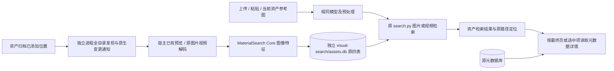

# 资产检索以图搜图链路研究

[CODEX_LONG_TASK_CONTINUE_V3]

- 当前状态：已更新并重启正式安装版 `D:/Program Files/Framekeep`，版本保持 `1.0.1 / 20261113145022`。963 份程序文件哈希通过，官方事务 complete、pending 清除；普通安装入口再次启动并连续 30 秒健康验证通过，当前正式桌面和引擎保持运行。原资料目录不变，实际图库自动建库保持默认关闭。
- 下一步：直接使用原快捷方式；在“资产检索 → 检索设置 → 开始 / 刷新建库”开启全部已添加归档及子目录的独立图搜图库。默认近似画面，不同角度可切相似内容。
- TODO：本轮安装与验证完成。更多真实场景、RAW/PSD、NAS 断线和大库性能仍需另测，不将样图库验收推广为所有图片的识别保证。
- 最近验证：79 项更新系统测试通过；21 项运行/画面核心单测通过；163 个冻结模块及 79 份网页资源与构建源码一致；安装前、安装后的真实冻结引擎隔离浏览器均通过，近似画面 3 张、相似内容 6 张，全屏正常，页面/API 错误 0。
- branch/commit：LR `feat/materialsearch-image-search`；冻结运行隔离 `ddda54d`，缓存与打包修复 `cd9a7a1`；画面匹配 `1175adf`。上游 core 保持 `28f9061`。仅本地提交，未推送或发布线上版本。
- 阻塞：本轮无。此前两项已知旧回归失败保留，未称全仓库测试通过。原有未提交源码修改保留，本轮从当前工作树构建，未将这些修改混入提交。

## 本轮范围

研究如何自动解析资产归档添加的全部数据，并接入资产检索的以图搜图。用户追加要求：拉取原开源项目源码分析改造；以图搜图独立用库，不能与元数据库混合；沿用原项目数据库类型以减少开发量、保持原功能。

以上追加要求覆盖此前共用 `asset_catalog.sqlite3 / intelligence_vectors` 的设计。第一轮完成研究与上游兼容原型；本轮按用户“改造后复制一些图片验证直到正常工作”继续实现源引擎接入和实际浏览器验收。未开启真实业务大库全量扫描，未下载或移动模型，未部署安装版。

## 已确认的原项目及拉取位置

| 项目 | 位置与固定版本 | 用途 |
| --- | --- | --- |
| [MaterialSearch](https://github.com/chn-lee-yumi/MaterialSearch) | `G:/app/MaterialSearch-source/MaterialSearch`；`aa05effad9d97a265d1045ebeb47e79e11192b86` | 原前端、功能和接口约定；本轮未改动 |
| [MaterialSearch-core](https://github.com/chn-lee-yumi/MaterialSearch-core) | `G:/app/MaterialSearch-source/MaterialSearch-core`；上游基线 `d0e6c39e372b405b1bfe54427c63d9bfbddd1e36`，本地改造 HEAD `28f9061c3c2f5265efe553b279fc66e83bb56420` | 原扫描、数据库、图片/文字特征、图片及视频搜索；本轮改造对象 |

本机 `D:/Program Files/MaterialSearchWindows/README_ZH.md` 的项目链接与上述仓库一致。Chinese-CLIP 是底层模型，不是 MaterialSearch 应用项目本身。当前主仓库公开前端，core 公开核心 Python 逻辑；本轮直接使用 core，不依赖未公开的 Web API 实现。

源码保留原作者及许可证：主仓库 GPLv3，core 的 `pyproject.toml` 标记 `LGPL-3.0-only`。未修改署名、未提交上游 PR，未反编译本机安装包。

## 数据库决定：独立文件，原类型和原表

**使用原项目 SQLAlchemy + SQLite；复用原 `models.py / database.py / search.py`，不另造视觉数据库结构。**

```text
软件资料目录/
  asset_catalog.sqlite3       # 现有资产位置、SKU、EXIF/XMP 等业务资料
  visual-search/
    assets.db                 # MaterialSearch 原类型、原表的独立检索库
    model-manifest.json       # 模型 snapshot、配置、预处理和维数约束
    scan-state.json           # 成功文件版本、checksum、失败断点
    worker-settings.json      # 独立进程初始化配置，不含模型 API 密钥
```

| 独立 `assets.db` 原表 | 原字段及责任 |
| --- | --- |
| `image` | `id/path/modify_time/checksum`；图片位置、时间、文件 SHA1 |
| `image_features` | `id/checksum/features`；图像 float32 特征二进制 |
| `video` | `id/path/modify_time/checksum`；视频位置、时间、文件 SHA1 |
| `video_features` | `id/checksum/frame_time/features`；采样时间及逐帧特征 |

正式工作进程首次导入 core 之前设置 `SQLALCHEMY_DATABASE_URL=sqlite:///实际资料目录/visual-search/assets.db`。上游在模块导入时创建默认 engine，**导入后再改环境变量不会切换连接**；因此在独立进程配置，不在 LR 主进程随意切换。

不再新增自定义 `visual_vectors` 表，不把原特征表附加到元数据库，也不把 LR 现有 `intelligence_vectors` 作为新图搜图权威库。旧数据原样保留，不在本轮删除或迁移。模型 revision、维数和预处理规格通过独立目录/清单约束；换模型时建新视觉库，不能只因维数相同就混用特征。上游目前也明确说明换模型需要重建特征。

两个库的主键不相同：LR 是资产标识，MaterialSearch 的图片 ID 是整数。正式适配要按规范化原路径关联，选中 LR 素材后查独立库的 `image.id`；不能把 LR 的 `item_id` 直接交给原 `search_image_by_image()`。最终一页结果可补读元数据详情，视觉特征入库与搜索本身不写元数据库。

## 当前 LR 链路的实证断点

1. `server.py` 创建 `ArchiveVisits`；`ReferenceLibrary.enqueue()` 在此模式下只登记位置，不递归扫描。隔离目录有 A/B 两个子目录、各一张图：添加后 `items=0`，只访问 A 后 `items=1`，B 尚未入库。因此仅对元数据库已有行执行“全量解析”不能覆盖全部归档文件。
2. `AssetIntelligence._discover()` 在 visits 模式下跳过后台发现，`tick()` 只消费当前访问目录的任务。旧任务 139 中的全库自动方案已被任务 204 的按访问模式改变，不能直接按旧文档判断现状。
3. `AssetIntelligence.tick()` 在 VLM 成功之后生成向量；`AnalysisWorkflow.tick()` 目前只写 `appearance-v1:192`，没有生成 Chinese-CLIP 向量。外观特征只是 8×8 RGB 配色/布局，不等同于语义检索。
4. `retrieval_store.save_result()` 会删除资产全部旧向量再重写。隔离实测已有 CLIP 向量 1 条，模拟新版描述结果保存后变为 0。独立原库方案会绕开这处耦合，描述解析以后也不能调用独立库的删除逻辑。
5. 现有 `/api/intelligence/image` 仍查询共库，界面参考图模式只传 root/threshold/limit，当前文字、维度及素材类型筛选不会全部叠加。接入新 worker 时要明确请求契约，不能只换按钮文案。

## 上游源码可以复用的部分与必须适配的边界

| 上游实现 | 复用或改造决定 |
| --- | --- |
| `process_assets.py` 图片/文字编码与单位化 | 保留；已抽出延迟加载接口，兼容现有入口 |
| `models.py`、`database.py` | 原 SQLAlchemy/SQLite 和四表结构保留；不建立第二套自定义存储 |
| `search.py` 图片 ID/上传图片/文字/视频搜索 | 优先复用；上传图可编码后调用原 `search_image_by_feature()`，无需往元数据库存参考图 |
| `Scanner` 的目录扫描、mtime/SHA1 跳过、checksum 复用、视频抽帧、扫描断点 | 优先接入现有机制；修改仅集中在归档位置输入和解码回调 |
| `config.py` 的导入时环境配置 | 在专用工作进程启动前指定，不污染宿主；原模块会打印配置，产品日志需避免输出密码字段 |
| 原扫描收尾的 `delete_record_if_not_exist()` | 只有本轮所有目标根目录完整、成功扫描后才允许用于对应范围；NAS 断线或部分扫描不能等同文件已删除 |
| 默认 `IMAGE_EXTENSIONS/IGNORE_STRINGS/IMAGE_MIN_WIDTH/HEIGHT` | 按归档支持范围配置；不能因默认后缀、目录含 `cache/thumb` 或小图尺寸静默漏掉用户加入的资料 |
| RAW/PSD/PSB 与专业视频 | 复用 LR 已有解码预览及视频工具；原项目普通 PIL/OpenCV 入口不能直接当成全格式支持 |
| 原查询 `all()` 后 `b''.join(features)` | 保持原功能完成第一阶段验收；大库后续测量峰值内存和耗时，再有证据地改为分批读取。首版不擅自换数据库或引入新 ANN 引擎 |

### 建议的最终链路



OCR/VLM 的 SKU、文字和画面描述是独立的附加业务。以图搜图的首轮建库不等待它们，也不通过图像相似度自动修改 SKU。图片图搜图只需生成图像特征；视频按原逐帧结构记录命中时间，抽样不代表理解每一帧。文本、音频或无法生成有效预览的文件不伪造向量，保留可解释的跳过/失败状态。

全部归档指已添加且启用检索的本地盘和可访问 UNC 根位置及子目录，独立于归档页面当前文件夹、分页和选择。原归档按访问浏览继续保留；自动建库由独立进程在后台执行，前台不递归扫盘。远端 API 目录需对应服务提供检索或授权读取接口，不能按本机文件路径处理。

## 第一轮上游兼容改造

- 新增 `src/materialsearch_core/embeddings.py`：`FeatureEncoder` 导入及构造不加载 Torch/模型、不连接数据库、不读取全局配置；默认 CPU、只从本地模型加载，按有上限的批次返回单位化 `float32`。图像和文字共用一个延迟加载实例，调用串行，可释放引用。
- 原 `process_assets.py` 的图片/文字入口委托该接口，保留原 CLI 在线加载行为；修复直接传入 PIL 图片时对 `len(image)` 的错误假设，保留原空输入行为。
- 兼容 Tensor 与新版 `pooler_output` 返回，使用推理模式，完整传递文字 attention mask，拒绝零向量、非有限数、行数或维数不一致。
- 保留原 `models.py / database.py / search.py`，新增独立数据库兼容测试，验证原图片 ID 搜索、checksum 去重及视频逐帧字段；不创建自定义视觉表。
- 源码增补说明和原始作者/许可均保留。可复现补丁：[232-MaterialSearch-core-归档特征接口.patch](../技术文档/补丁/232-MaterialSearch-core-归档特征接口.patch)，对应固定上游基线；已在基线源码副本上执行 `git apply --check`。

## 第一轮研究实测与限制

| 验证 | 本轮实际结果 |
| --- | --- |
| 上游专项测试 | `PYTHONPATH=src python -X utf8 -m unittest discover -s tests -q`，15 项通过，最终一轮约 0.447 秒 |
| 真实模型与原库 | 本机 Chinese-CLIP large-336；2 张合成图形成 `2×768 float32`，范数约 1；含加载约 8.454 秒；文字 `1×768`，约 72.72 ms |
| 原搜索接口 | 原 `search_image_by_image(image_id)` 对独立库返回参考图第一，约 1.44 ms；分数 1.000000119 为 float32 舍入，不作为概率 |
| 数据隔离 | 独立库恰为 `image/image_features/video/video_features`；旁边元数据库仅有原 `items` 表，记录与表不变 |
| LR 现状探针 | 新根目录未访问子目录不会入库；无向量时无命中；旧描述保存会清除 CLIP；文件版本变化后旧向量被排除 |
| LR 当前回归 | 本轮未改 LR 产品代码；71 项现有用例报告 7 个 failure、2 个 error；另 6 项定向用例中 5 项后端通过、1 项浏览器等待首批结果超时。未宣称全套通过 |

LR 失败包括旧缩略图缓存/预热预期、仅用 `__new__` 构造服务缺少新增成员、单字关键词及旧并发阶段统计；某个缩略图用例同时出现断言与清理异常，不能把错误条数当不同失败测试数量。浏览器用例在参考图操作前等待初始结果即超时。本轮没有修改这些生产实现，也未逐项修复或将其认定为新改造回归；正式接入前需要建立准确基线。

原型使用合成图片和临时库，无真实业务原片写入。上述耗时受 OS 缓存和本机环境影响，不是服装同款准确率、生产大库性能或全格式兼容承诺。本机测试环境 Torch `2.6.0+cu126`、Transformers `5.7.0`、NumPy `2.4.4`；上游当前依赖声明更窄，本轮没有全局安装、降级或修改依赖约束，仅证明本次路径兼容。

机器可读结果见[验证记录](../技术文档/验证记录/232-以图搜图源码研究.json)；临时探针和详细结果位于忽略目录 `build/archive-image-search-research/`。早期共库探针仅用于定位旧链路，不能作为当前决定的存储方案。

## 正式接入顺序与验收（研究时计划）

### P1：独立工作进程及原库接入

固定独立目录、数据库 URL、模型目录、扫描临时目录和只在本机加载的配置。启动前校验目标不是元数据库，防止默认相对路径误建库；保留模型 manifest 以阻止错模型共库。独立的图片/文字查询适配原 `search.py`，把原项目结果转换为当前页面需要的路径、预览、分数及视频时间。

验收：真实图片通过新进程写入原四表并在页面搜到；元数据库没有新增视觉表；退出回收工作进程；无模型时明确报错，不以颜色特征冒充语义检索。

### P2：所有归档位置自动建库

资产归档添加/移除位置后通知独立进程，复用原 Scanner 增量机制；不把元数据库已发现行当全部来源。新增目录和已添加历史目录均覆盖子目录；提供完整发现中的状态，不在未知总量时显示“100%”。避免一边扫描一边因 NAS 断线执行全库缺失清理；扫描与推理低优先级，不拖慢拍摄和前台浏览。

验收：从未访问的多层子目录也可命中；新增只补新增、未变照片复用；重启和暂停可恢复；删除/离线/移动按来源状态更新；断线不误清空其他根；原片与人工 SKU 不变。是否自动运行跟随新的独立图搜图开关，不复活旧的 OCR/VLM 全库自动模式。

### P3：预览及素材类型接入

图片参考与建库使用相同方向、RGB 和模型预处理，RAW/设计文件优先复用现有有效预览；视频保留原时间字段与命中片段。原文件变化前后校验，读取失败、部分复制和无效预览可重试；不要先删旧有效记录再进行可能失败的推理。

验收：选取真实 JPG/PNG、RAW、PSD 与代表性视频格式运行；同一画面不同来源预览可检索；视频时间正确；不支持项明确记录，不静默计作完成。

### P4：实际效果和大库验证

用实际服装样本评估同图、压缩/裁剪、同款多角度、同色异款、不同背景及无关图；相似度不显示为同款概率。先评估原查询在目标数量下的响应与内存，再决定是否只对原 SQL 取数和批次做优化。以图搜图仍使用原数据库和功能契约。

验收：报告真实样本量、Top-k 召回、误匹配和未索引覆盖；明确原图离线时能否检索缓存特征及预览；页面显示已建库/待处理/失败数量，空索引与无匹配分开。通过后再做应有的本机安装与交付。

## 2026-11-14 源引擎接入与复制样图交付

本轮用户明确要求完成改造后复制图片验证，已完成以下实现和流程验收。用户随后指出旧截图存在无关 Logo；此前仅同图首位和流程通过不足以验证结果相关性，相关性结论以文末纠正记录为准。P1/P2 已落地；真实 RAW/PSD 文件集、真实 NAS 断线和大库性能未实测。

### 主要实现

- `选片助手/material_search.py`：独立配置、后台进程与状态、全部归档位置同步；复用宿主 `DirectoryChanges` 原生通知，仅补充增删改的文件，30 分钟完整对账覆盖漏通知；暂停、重启恢复、失败重试。关闭开关不扫描归档或加载模型。
- `选片助手/material_search_worker.py`：在模型进程中先固定独立数据库 URL，再导入上游；沿用原四表、SHA1/checksum 去重及原图片/视频搜索接口。完整发现不依赖当前归档分页或元数据库已有图片行。损坏图单独失败、成功项继续；部分目录读取错误保留可读图片，禁止缺失清理；系统目录与资料缓存排除。
- `选片助手/vendor/materialsearch_core/`：携带已拉取的公开源码、原许可证和来源记录；原数据库和查询实现保留。视频采样从 BGR 转 RGB，并与普通图片共用同一模型实例。
- `material_search_preview.py`：只读方向/RGB 预览；原图不写入，模型不复制。RAW/设计文件复用已有读取方式；相关实际文件集未在本轮承诺覆盖。
- `asset_intelligence.py / analysis_workflow.py`：正式图片及文字语义查询走独立库；VLM 描述不再生成元数据库图像向量。旧表和历史备份兼容保留，不清除用户原数据。
- `asset_catalog.py`：只增加独立结果的只读定位和预览适配，不把未访问图片插入元数据库。独立结果标识包含原项目整数 ID、原路径及文件版本摘要，避免 SQLite 复用整数 ID 后把旧搜索结果指向另一张图。
- `演示方案/asset-retrieval.js`：检索设置增加独立自动建库、开始/刷新、暂停/继续、重试和进度，根目录筛选、上传参考图、结果继续搜图、缩略图及全屏预览接通。首次开启由用户操作，测试没有开启真实业务库解析。
- `build_release.py`：纳入 worker、预览辅助源码和带许可证的 core。按同样布局使用 MaterialSearch 自带 Python 实际运行通过；没有执行完整安装器构建或覆盖安装版。

### 复制图片与浏览器验收

复制 `演示方案/assets` 的 6 张真实服装 JPG，分放 A 与 B/deep 子目录，再复制 1 张品牌 PNG 作为不同内容，共 7 张；归档从未逐层访问，仍全部建立独立索引。

真实 HTTP 与 Edge 浏览器验证：开启建库、上传图片、同图首位（最终一次相似度约 0.998994）、7 个缩略图全部成功解码、结果继续搜图、2048 大图真实解码显示及关闭；页面异常和相关 HTTP 错误均为 0。约 0.778 秒为该次查询实测，非性能保证，不是同款准确率。

随后验证暂停时不收新图、继续仅补新增、原生通知自动增删、SQLite 整数 ID 复用后旧结果被拒绝、重启复用全部成功项、删除副本更新索引、坏图报错后修复重试、原项目视频逐帧入库及命中帧预览、移除归档位置立即不再命中。两库核对：元数据库资产行 0、向量行 0；独立库恰为原四表。源照片 SHA-256 保持。

复制样图与证据在 `build/archive-image-search-integration/`：`photos/`、`browser-lifecycle-result.json`、`image-search-results.png`、`image-search-fullscreen.png`、`index-ready.png`。正式打包布局的 `bundled-runtime-result.json` 记录 MaterialSearch 自带 Python（3.12.9）完成两图入库与首位命中，测试数据库独立于原软件数据。

### 问题修复与最后验证

- 修复重启时尚未发现便先显示旧“完成”状态；开始新一轮发现前立即更新阶段，结果只按实际完成回报。
- 修复 Windows 默认编码导致中文坏图错误把 JSON 行通信线程弄退出：启动参数、环境及 stdout 明确 UTF-8，异常路径也验证通过。
- 修复孤立整数 ID 的过期引用，并将未访问图片的可视化结果与元数据库主键分开。
- `python -X utf8 -m unittest test_material_search -q`：8 项通过，0.033 秒，包含独立库拒绝混用、模型版本、无模型启动副作用、过期引用及部分目录读取边界。
- 设置 `FRAMEKEEP_TEST_REAL_CLIP=1` 后运行 `test_material_search_integration`：真实模型浏览器与全生命周期通过；最后所在联合验证为 8 项、52.900 秒（当时 7 项单元 + 1 项端到端）；新增目录边界单元随后包含在上述 8 项单元中再次通过。
- `test_asset_intelligence / test_analysis_workflow`：明确排除两项已知旧失败后，59 项通过，71.848 秒。排除的是既有单字中文检索用例，以及 OCR/VLM 页面停止继续用例；后者使用 `08e78ed` 的改造前后端模块独立对照，也在相同等待点失败。未把这两项称为通过。
- 原大型 LSH 用例改为直接验证历史存储函数；备份用例显式植入历史向量 fixture，同时断言新描述不生成元数据库向量，保留旧库兼容性。
- 受影响 Python 编译、前端语法、提交 diff 检查通过。打包布局验证使用原项目内置 Python，不依赖开发 Python；实际查询首位分数 1.0。

实现已提交 `b882639`。`asset_catalog.py / build_release.py` 原有用户修改通过单独构造本任务暂存补丁保留；`server.py` 未改动。当前安装版、正式版本号和业务资料不变，未推送远程。

接续时从本文顶部核对，已通过的样图与布局验证无需机械重跑；安装版或新的真实格式/规模验收应另按实际目标推进。

## 前一轮内容相关性复查：Logo 混入旧测试截图

用户确认质疑的是此前测试截图。复查发现两处过滤问题：共享参考区默认最低相似度为 50%，资产检索和 LAN 请求又固定发送 `threshold:0`。原项目 `IMAGE_THRESHOLD` 默认 85。旧测试甚至把返回全部 7 个资产作为预期，虽然验证了同图首位和缩略图，却没有把第 7 张 Logo 当负样本排除；这是验收遗漏。

### 数据库与编码审计

只读检查原测试独立 `assets.db`：原四张表，7 个 image 记录、7 个 image_features，全部 BLOB 为 3072 字节（768×float32）。7 个路径均存在，实际文件 SHA1 与原表 checksum 全部相同，向量无 NaN/Inf 且范数约 1。

另用 `ChineseCLIPModel / ChineseCLIPProcessor` 直接从 7 张原图重新编码，与库中每个向量逐元素比较，**最大绝对差均为 0**。因此本样本的数据库和图像特征正确，无需因本问题重建索引。

以 `XSY_0929.jpg` 为参考：其余裤子视角得分约 0.952–0.997，自己为 1.0，Logo 为 0.547197。50% 会放行该 Logo，这不代表 54.7% 的同款概率。未入库的另一视角 `XSY_0960.jpg` 对裤子得分约 0.914–0.969，对 Logo 约 0.558。

完整审计在忽略目录 `database-feature-audit.json / relevance-audit-result.json`，结果已纳入本任务机器可读验证记录。

### 修复与新验收标准

- 共享参考区默认恢复 85%，桌面、快捷窗与 LAN 均按滑块实际值向后端发送；后端省略参数时也使用上游图片默认 85%。文字语义搜索仍使用原文字默认值 36%，没有一起提高到 85%。
- 后端先过滤再返回候选，并回报 `threshold_applied`；拒绝无效、越界或非有限阈值。显式放宽仍可探索低相关候选，但界面显示提示。
- 滑块变化触发防抖重新查询，避免后端已经按 85% 筛选后，前端降到 50% 却无法取回较低分候选。LAN 的请求代次 key 也纳入阈值。
- 不按文件名、扩展名或 Logo 类型屏蔽素材：以 Logo 自身为参考时，仍须正常返回它。
- 验收从“同图首位”扩展为：默认裤子结果 6 张、无 Logo；未入库的同款视角返回 6 张裤子、无 Logo；Logo 查询仅 1 个 Logo；界面截图查询为空；显式放宽到 50% 后 7 个候选重新可取，恢复 85% 后回到 6 个。
- 截图前须确认预期图片数量、真实解码、图片 opacity 和加载动画完全消失，避免把加载占位图当作已显示图片。新截图 `image-search-relevance-fixed.png` 已实际目视检查，6 张均为参考裤子相关图片。

该轮验证：10 项阈值/独立库单测通过；共享参考区 UI 的请求和键盘滑块、粘贴、拖放通过（该 UI 用例使用明确的确定性后端 fixture，不作为模型准确率证据）；真实模型浏览器和完整生命周期 1 项通过（63.385 秒，含上述正反例及原来的增删、恢复、坏图、视频检查），页面和 API 错误均为 0。原项目内置 Python 按冻结布局复测：数据库保留 2 张图，默认阈值 0.85，裤子查询返回 1 张且不含 Logo，首位分数 1.0。这些结论只验证了内容相似，未满足后续明确的无手正面画面要求。

此前 59 项回归与 2 项旧失败属于前轮记录，本轮没有声称重新全量通过。相关性修复已提交 `bf69c0a`，未推送或部署安装版。本轮证据只覆盖这组样图和指定正反例，不能推广为任意商品的同款识别准确率保证。

## 从同款内容相似纠正为近似画面

用户再次指出参考图无手、纯正面，而六个结果包含带手和侧身。这暴露的是匹配目标错误：此前把同款内容作为正例，没有将姿态、构图和局部变化纳入默认验收。逐张目视核对后，`0929/0930/0933` 为无手正面，`0937/0941` 带手，`0945` 带手且侧身。

### 两种明确的查询方式

- **近似画面（默认，API `match_mode=frame`）**：原 CLIP 向量召回后，读取候选有效预览，用 SIFT 匹配点和受限 RANSAC 二维对齐，再按 RGB SSIM 比较可比区域。只保留画面细节分数达到门限的结果，并按该分数排序。图片卡片明确显示“画面相似度”。
- **相似内容（API `match_mode=semantic`）**：保留原项目图片/文字/视频语义搜索，允许同款不同姿态和角度；显示内容相似度。文字查询自动走此方式，原文字默认阈值不变。

这不是把 CLIP 的同一分数再提高一次：响应同时保留原 `semantic_score`，默认结果 `score` 是画面核验值。滑块门限对当前匹配方式生效，桌面、快捷窗和 LAN 共用同一组件；LAN 服务也转发匹配方式，避免浏览器切换后被后端忽略。

新增 `material_search_detail.py`，复用原有 OpenCV/NumPy/Pillow，无额外模型下载，也不增加数据库表。局部特征、颜色和结构从实际预览计算，没有按文件名、肤色或“禁止所有手部”编写过滤规则。查询时最多核验 256 个候选，并有时间预算；无法核验的候选跳过，部分完成通过 `incomplete` 提示，不将语义分数冒充画面核验分数。预览特征缓存按文件版本区分，最多 32 项。

方法依据：[OpenCV 局部特征匹配与 RANSAC](https://docs.opencv.org/4.x/d1/de0/tutorial_py_feature_homography.html)、[SSIM 原作者说明与论文](https://ece.uwaterloo.ca/~z70wang/research/ssim/)。本实现限制小幅缩放/旋转/平移及可比区域覆盖率，优先保证近似画面的精度；不承诺通用手部检测或跨任意构图的姿态属性判断。

### 原图对比与实际页面结果

同一参考 `XSY_0929.jpg` 的原图直接对比（界面上传会经过 JPEG 整理，分数略有差异）：

| 候选 | 目视核对 | CLIP 内容分 | 画面细节分 | 默认结果 |
| --- | --- | --- | --- | --- |
| XSY_0929 | 无手正面 | 1.000 | 1.000 | 保留 |
| XSY_0930 | 无手正面 | 0.997 | 0.969 | 保留 |
| XSY_0933 | 无手正面 | 0.990 | 0.895 | 保留 |
| XSY_0937 | 有手 | 0.977 | 0.803 | 排除 |
| XSY_0941 | 有手 | 0.957 | 0.796 | 排除 |
| XSY_0945 | 有手侧身 | 0.952 | 0.736 | 排除 |
| Logo | 无关图形 | 0.547 | 画幅不可比 | 排除 |

完整原图比较记录为 `frame-comparison-audit.json`。实际 Edge 页面默认返回前三张；未入库的另一张无手正面 `XSY_0931` 也返回相同三张，不依赖原图已在库内。以带手 `0937`、侧身 `0945` 反向查询，各自返回自身；以 Logo 查询仍返回 Logo，界面截图不凑结果。显式切换“相似内容”仍能返回六张同款多角度照片。

新证据：`image-search-frame-match.png`（三张正面）、`image-search-content-mode.png`（明确内容模式）、`relevance-unindexed_front_without_hands.png`、`relevance-hands_query.png`、`relevance-side_query.png`。截图等待图片真实显示和加载动画消失后生成，已实际目视检查。

### 验证和数据边界

- 最后一次联合命令包括 `test_material_search_detail`、`test_material_search`、参考区组件用例、LAN 模式转发用例及真实模型端到端：**21 项通过，72.664 秒**。覆盖图片缩放/JPEG、局部修改、不同颜色、缺少关键点、画幅不可比、缓存版本和边界，以及实际画面正反例。
- 参考区旧用例原来混入目录浏览启动条件，改为直接检验生产共享组件的状态、模式和粘贴/拖放回调；完整页面与实际 HTTP/模型由真实端到端验证，不将组件 fixture 当模型质量证据。
- 除未访问目录的独立结果 ID，还手动访问 A 目录建立元数据 ID，再验证同样三张结果、缩略图和结果继续搜图。搜索建库阶段元数据库资产行 0、向量 0；手动访问后仅产生该目录应有的 3 个资产，向量仍为 0。
- 新增/删除通知、暂停恢复、重启复用、坏图修复重试、旧整数 ID 拒绝误指、匹配视频采样帧及移除位置仍通过。测试视频保留原图画幅，以对应近似画面的目标。
- 原项目内置 Python 按打包布局复核，加入新的画面模块后，7 张库内默认同样只返回 `0929/0930/0933`。原 SQLAlchemy/SQLite 四表和 CLIP 索引保持，不需重建已有向量。
- `build_release.py` 只暂存新增的画面 helper，原有用户修改保留；LAN 仅提供公开结果字段，本机诊断路径留在桌面。未重打包安装版、未部署、未推送。

实现提交 `1175adf`。当前验证只覆盖这些图片与输入变化，更多服装场景、真实 RAW/PSD、NAS 断线和大库表现仍需另行验证。

## 2026-11-14 正式安装版更新交付

用户明确要求“执行更新”。目标与资料位置均为原安装 `D:/Program Files/Framekeep` 及其 `data`，执行前未运行、无未完成安装事务。沿当前工作树构建，正式版本及构建号保持 `1.0.1 / 20261113145022`；本次为本机修复安装，不上传或发布新版。

### 构建、冻结边界修复与验收

使用现有构建和官方更新事务，不直接覆盖受管程序。更新工具、PyInstaller 引擎及 Rust release 全部重建；最终验证 163 个冻结业务模块（代码归一化比较）、server 入口、79 份网页资源以及独立 worker/core 数据资源与源码一致。构建期间输入源码哈希保持。

完全冻结的 EXE 在安装前暴露两处问题，均在替换正式程序之前解决：

1. 原先把 worker 的目录加入 `sys.path` 时，冻结包根部只有扩展/数据、没有 Python `__init__` 的 `simplejson` 目录被外部解释器误认为命名空间包，Requests 导入 `JSONDecodeError` 失败。独立命令同样复现。改为专属 `material-search-runtime/`，只放完整 worker 源码及 core；外部进程清理 Python/PATH 污染，并只在模型子进程恢复标准 Windows DLL 搜索，不改变主程序。
2. 实际验证会在程序目录生成 `__pycache__`，而原源码 vendor 也可能已有缓存。签名包安全检查正确拦截，未绕过检查。改为 `-B`、`PYTHONDONTWRITEBYTECODE` 和 worker 内部禁写字节码，并用源码白名单收集运行目录，不把缓存或无关文件带入安装包。新增真实子进程与打包排除用例。

方法参考：[PyInstaller 冻结程序启动外部进程的官方说明](https://pyinstaller.org/en/stable/common-issues-and-pitfalls.html#launching-external-programs-from-the-frozen-application)。源码中 `worker_directory()` 在冻结环境要求独立目录存在，资源不完整时明确报修复安装，不回退到受污染目录。

最终冻结验收直接运行真实 `framekeep-engine.exe`，不再以手工模拟布局代替：分别从发行目录和正式安装目录启动，使用独立端口、独立 data、7 张复制照片和原 MaterialSearch 内嵌 Python。自动建库、默认三张无手正面、显式内容六张、缩略图、2048 全屏实际解码和模式切换全部通过。元数据库图片行/向量行均 0，图搜图库仅原四表，源照片 SHA-256 不变，程序运行目录没有新字节码缓存。

### 安装与原资料保留

- 事务：`D:/Program Files/Framekeep/.update-state/local-materialsearch-20261114`，状态 complete；安装 marker 及现有注册保留原身份，pending 清除。
- 使用进程内临时 Ed25519 密钥签名验证本地包，安装配置保留正式更新公钥；未存储私钥、未修改远端。完成后 963 份受管文件 SHA-256 均与 manifest 相同。
- 程序启动前对 52 份原资料文件的大小、mtime 和校验值比较一致。512MiB 以下完整 SHA-256，更大文件取 5 个 1MiB 样本；安装包排除 `data/`。25GB 资产库未复制、迁移或替换；配置和小库保存一致性快照，模型目录未移动，未执行组件重新准备。
- 桌面 PID67944、正式引擎 PID71560 本次启动健康确认；`/api/ready` 返回 ready/services_ready=true。4 份关键前端资源经实际 8769 HTTP 与源码逐字节核对一致。
- 真实生产数据的图搜图开关 false，`visual-search-settings.json` 及 `visual-search/assets.db` 均未因验收生成；隔离验收只在本轮 G 盘目录写入测试库，未开启全部真实归档建库。用户点击正式界面的开始/刷新后才按现有归档位置处理。

### 证据、清理和范围

最终证据目录 `build/materialsearch-install-20261114-r3/`：`source-verification.json`、`qa-stage/result.json`、`qa-installed/result.json`、`data-preservation.json`、`installed-result.json`、`production-readonly-verification.json`、`cleanup-result.json`。首轮失败诊断和 79 项更新测试日志保留在无 r2/r3 后缀的原证据目录；r2 保留中间校验报告。

回收本轮 3 份中间引擎、2 份失败的暂存发行副本、1 个不完整签名 ZIP，共 **4,021,424,202 字节**；G 盘可用空间实测由 216,308,453,376 增至 220,336,799,744 字节，增加 4,028,346,368 字节（包含同期磁盘活动）。实际删除前检查绝对边界、数据库与重解析点，安装后验收通过才清理。最终完整发行目录、成功签名包、原始暂存备份、安装回滚目录、数据快照、源码、模型及业务资料均保留。

运行隔离修复提交 `ddda54d`、源码收集/禁缓存修复 `cd9a7a1`；`build_release.py` 原有 18/7 行差异保持，其他用户文件不混入本任务提交。未重复 GitHub 同步、未 push、未发布线上安装器。当前关于安装状态以本节及文档顶部为准，前面各源码阶段“未部署”是当时记录。

安装验收后曾观察到正式进程退出、8769 不可达，原因未判定，日志未见新的异常堆栈；没有将其假定为用户关闭或程序崩溃。随后通过原安装入口以正常桌面方式再次启动，正式桌面 PID85232、引擎 PID74068 连续30秒三次 ready/services_ready=true，原自动图搜图开关仍为 false，进程在校验脚本结束后仍保持。该次记录为 normal-entry-relaunch.json；安装事务原启动健康记录仍保留，不覆盖历史证据。
