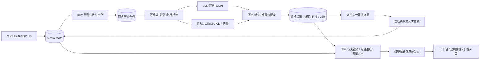

# 多模态 SKU 资产检索架构

## 目标、入口与隔离

2026-10-27 已将仓库全部分支的最新功能与修复汇总到主项目 `G:/app/LR`，集成分支为 `feat/integrate-multimodal-main`，来源及验证清单见任务 115。默认正式身份为 `com.framekeep.culling`、8769 管理端口及原有资料位置。

独立开发工作区 `D:/data/codex/work/multimodal-sku-search/LR` 同步汇总后的源码；专用启动器通过 `TAURI_CONFIG` 构建 `com.framekeep.culling.multimodal-dev`，仍使用 8779 和 `.framekeep-search-dev`，不开启 Canon 系统关联。开发阶段 Web 可免访问码，冻结正式版保留认证。

2026-10-27 已将原版截至 `ff000ab` 的 15 个已提交更新合入本开发分支。合并范围、验证和限制见 [任务 113](../开发任务/113-原版最新更新合入开发版.md)。开发版开机启动项为独立 `FramekeepMultimodalDev`，源码构建通过本目录启动器恢复隔离运行环境。

双击 `启动多模态检索开发版.cmd`。每次由 Cargo 增量检查桌面开发程序；已部署本机模型时初始化独立的内置模型卡片。运行时只引用原项目 ExifTool、FFmpeg、Qwen 和 GLM 文件，不复制模型或使用原归档数据库。缺少模型时在 AI 助手配置中选用 Chat/Responses 视觉 API 或部署内置模型。

“资产检索”位于“拍摄进度”左侧。“资产归档”的“以图搜图”优先使用当前选中素材，也支持上传/拖入/粘贴参考图。桌面运行时默认 `Ctrl+Shift+Space` 唤出独立置顶搜索窗，支持关闭/恢复主窗口后的快捷搜索；关闭程序后快捷键随进程释放。Windows 的 `Win+Space` 是输入法切换，不接管该系统组合键。可设置 `Alt+Space`、`Ctrl+Alt+F` 或关闭；注册冲突保留原键并提示。

## 数据流与职责



- `asset_intelligence.py`：调度、模型调用、版本检查、组提案、人工确认与服务生命周期。
- `retrieval_schema.py`：解析契约、自定义维度校验、NFKC 规范化与中文双字分词。
- `retrieval_store.py`：表和索引、原子写入、多路召回、分页、向量候选与精排。
- `visual_features.py` / `clip_worker.py`：有界参考图解码、本地特征和独立模型进程。
- `asset-retrieval.js/css`：搜索、维度、资料、任务、复核、模型设置与快捷窗共用交互。
- `quick_search.rs`：Windows 热键消息线程、独立 WebView、原生 Acrylic 背景、主窗口联动。

## 数据模型与一致性

沿用 `asset_catalog.sqlite3` 的 WAL 和位置主键，所有扩展表采用 `IF NOT EXISTS` 安装，重复启动不重写存量结果。结果包含配置摘要（契约版本、模型 ID/地址、维度、采样和向量方案）及源文件版本，不保存模型密钥。原始媒体、参考图二进制不写业务数据库。

| 表 | 责任与索引 |
|---|---|
| `intelligence_settings` | 本机开关、自定义维度、采样、快捷键与索引类型 |
| `intelligence_meta` | 检索代次；资料、SKU 和文件版本变化使旧游标失效 |
| `intelligence_dirty` | 增量待调度资产；扫描变更触发器只插入 ID |
| `intelligence_jobs` | 唯一 `(item,fingerprint,config)`；`status,due,created` 队列索引 |
| `intelligence_results` | 每资产当前结果、模型、逐帧时间点、配置与版本 |
| `intelligence_dimensions` | `(item,frame,key)`；按 `key,normalized,item,frame` 查找 |
| `intelligence_fts` | 标准 FTS5，资产 ID 与中文双字/拉丁词分别倒排；输入始终参数绑定并转义 |
| `intelligence_vectors` | `(item,frame,backend)` 归一化 float32 向量；带源版本 |
| `intelligence_lsh` | 8 个随机超平面分桶，每桶 10 位；`backend,band,bucket` 倒排 |
| `intelligence_groups` | 根目录+直接父目录的提案、版本签名、SKU 与可解释证据 |
| 既有 `corrections` | 自动/人工归组均写审计；人工 SKU 优先 |

文本、维度和向量查询均校验结果版本与 `items.fingerprint` 一致；删除归档位置、离线或变化后的旧资料不会继续命中。物理文件在解码前、提交前检查 size/mtime，提交事务再次核验任务、配置与库版本。目录指纹沿用既有路径+size+mtime_ns 语义，不宣称能识别被刻意恢复同大小同时间的内容篡改。

RAW/JPG 沿用现有 `capture_items` 配对代表与 `pair_key`。归组更新配对索引成员，保留原片，只写数据库；原有人工 SKU 修正继续走既有接口。跨库文件元数据写回仍为现有显式业务，不因视觉归组自动修改原片。

## 解析、任务与恢复

基础维度包括品类、款式结构、主体颜色、材质、纹理、场景、构图、景别镜头、光线、情绪、人物、动作、品牌文字和适用场景；同时保留摘要、关键词、可见文字、SKU 候选、商品身份、主体款数和置信度。自定义维度最多 20 项、每项 32 字符，忽略大小写去重。

复用 DIT-tools 的结构化维度与逐帧语义，而不搬移 Qt/C++ UI。视频默认均匀抽取 3 帧，可设 1–8 帧；每帧独立解析及索引，保留秒数，组合维度要求同一帧成立。均匀采样不能保证覆盖短暂内容或精确镜头边界。

两个解析工作线程复用模型卡片容量限制；本机推理由现有模型运行时互斥，防止 OCR/VLM 中途卸载彼此。图片和视频解码、VLM、CLIP、查询线程分离；HTTP 入队不读取整批原图。发现线程按 128/256 条分批推进，活动任务达到 1000 时暂缓补齐。单次人工选择最多 2000 项。

状态链：`queued → running → completed`；暂时性限流/服务错误最多三次、指数退避；永久错误进入 `failed` 并保留原因。源或配置变化进入 `stale`，新版本独立排队。重启把运行中任务恢复为等待；暂停阻止提交并保留队列，取消后返回的模型结果丢弃。已取消任务不会被普通自动补齐重新唤起，人工重试才恢复。配置变化补齐现有资产；已解析旧配置在新结果成功前仍保留可查，源文件版本变化则立即排除。

本机 Qwen 使用 llama.cpp JSON Schema 响应约束，API 仍校验 JSON Schema。格式失败不会写入可搜索结果，保留任务错误供重试。不以空值填充伪造模型成功。

## SKU 归组规则

1. 只检查同一直接目录的图片，不把整个磁盘或祖先目录直接当款号。
2. 至少 2 张、最多 2000 张；全部完成当前文件版本解析，所有主体均为单款且模型商品身份置信度不低于 0.88。
3. 商品身份必须含足够具体的款式结构，且规范化后的身份、品类和主体颜色全部一致；同色、通用品名或人物姿势不是同款证明。
4. SKU 来源为可见文字、现有归属或直接父目录名，必须通过已有公司前缀/后缀和长度规则；默认支持 `LC`。只有一个规范化 SKU 候选才可自动确认。既有路径规则仍是候选证据，检索标注“尚未内容确认”，不等同于 VLM 确认。
5. 部分解析、混色、混款、多主体、多款号、置信不足或无有效款号进入复核，显示原因、覆盖数和候选。人工填写款号并确认时保留完整审计。
6. 提案签名包含每张图 ID、文件版本、SKU 和归属来源；确认时重新验证，避免陈旧弹窗覆盖较新的操作。已有人工归属冲突必须逐张处理。

此策略偏保守：自然语言描述不一致可能使同款进入复核；模型自报置信度不是经业务样本校准的准确率，不能承诺零误归组。界面可关闭自动确认，生产使用应先用实际服装照片评估。

## 检索与性能边界

SKU 范围查询使用现有 `catalog_items_sku` B-tree；文件路径、已读 EXIF/XMP、多维 FTS 分别召回 ID 后合并，避免单个 OR 迫使整个媒体视图扫描。精确 SKU 优先、前缀其次，其余按最近资产稳定排序。高频短中文沿时间索引取页，通过 FTS 资产 ID 与关键词交集核验单项，不先展开几十万命中；单字中文在该资产的索引文本中按字面匹配。筛选建议按维度和值游标跳跃，不在交互请求中聚合整库维度计数。只对最终页批量读取摘要与逐帧资料，避免排序时携带整库 JSON。默认 60、最多 100 项，以条件摘要、索引代次和 `(priority,-modified,id)` 编码游标；索引变化要求重新搜索。

向量均使用真实图像数据：

- 外观索引为 8×8 RGB 布局/配色特征，不提供语义承诺。
- Chinese-CLIP 使用本机已安装 `OFA-Sys/chinese-clip-vit-large-patch14-336px`，768 维单位向量；只复用模型资源，通过公开 transformers API 调用，独立进程、不读取 MaterialSearch 数据库或受保护代码。
- CLIP 默认 CPU 4 线程，避免与 VLM、OCR 和视频解码争抢显存；开发环境可用 `FRAMEKEEP_CLIP_DEVICE=cuda` 明确指定 GPU。独立进程屏蔽无关 TensorFlow/Flax 初始化，禁止联网下载。
- 作用域内不超过 10000 个向量时精确余弦；更大规模走 8 路 LSH 和一位邻桶，最多 6000 个候选、256 向量一批精排。这是近似召回，不保证找全；时间预算用 `incomplete` 标记，不冒充完整结果。
- 文字 CLIP 搜索与关键词结果以 reciprocal rank 融合，始终保留 SKU 命中优先级。模型缺失或索引为空明确提示，不能以随机向量或空壳替代。

文本查询有 2 秒 SQL 预算，向量精排有 3 秒预算；全库短词和高命中率多维筛选仍随候选规模增长。本地 SSD、数据库体积、CPU、网络盘吞吐和模型决定实际容量与延迟，不将合成 SQL 基准等同真实素材端到端表现。

## 备份、接口与发布

检索设置提供“备份检索数据库”，使用 SQLite online backup 捕获一致快照，保存到开发资料目录 `backups/` 并执行 `quick_check`。备份含归档路径、SKU、解析、维度和向量；不含原片、模型、API 密钥、拍摄库或外部图片。恢复前关闭程序，另存当前数据库后再替换，不把 SQLite 的活跃 WAL 文件直接当备份复制。

读接口：`/api/intelligence/state`、`search`、`facets`、`details`、`item`。写接口：`config`、`enqueue`、`control`、`image`、`group`、`backup`。全部仅监听 127.0.0.1；沿用 Host、Origin 和随机写令牌校验。参考图不设置文件体积上限：浏览器二进制流式上传，工作站提取 RAW 内嵌图或缩小普通图片至 1600px；模型响应与自定义字段仍按其契约校验。

发布资源清单已加入快捷页、JS/CSS 和独立 CLIP 工作脚本；正式打包仍使用已有 `build_release.py` 流程，需要相应运行时。当前交付为独立源码分支和可运行开发版，不替换正式安装、不变更正式版本号。

## 验证命令与实际结果

```powershell
$env:FRAMEKEEP_EXIFTOOL='G:\app\LR\.runtime\exiftool\package\bin\exiftool.exe'
cd 选片助手
python -X utf8 -m unittest test_asset_intelligence test_asset_retrieval_browser test_local_inference -v
cd ..
cargo build --locked --manifest-path 桌面程序/Cargo.toml
python -X utf8 选片助手/benchmark_intelligence.py --rows 100000
```

已实际调用 Qwen2.5-VL 7B Q4，对自建服装示意测试图用约 6.3 秒返回合法多维 JSON 并读出 LC1234；不作为真实服装识别准确率评测。Chinese-CLIP 在 CPU 完成实际图片和文字 768 维编码，含启动约 10.52 秒。最终百万条合成库 2556.52 MB，SKU 查询中位约 5.69 ms、中文词约 18.65 ms、双维度约 4.25 ms，`quick_check=ok`，全部无超时；不含原片、缩略图或模型耗时。真实 HTTP 端到端目录入库、VLM、CLIP 与三种检索用时 26.67 秒，测试原图 SHA-256 未变化。

最终测试计数、百万条基准及桌面实际运行状态记录在 `开发任务/108-多模态SKU资产检索系统.md`，以该任务文档最后验证为准。


## 局域网 Web 团队工作台

### 使用

1. 重新启动开发版，进入“资产检索 → Web 共享”，或“设置 → 文件与备案 → 管理 Web 工作台共享”。
2. 启用局域网共享，默认端口 8780；保存后复制显示的局域网 IP 地址。开发阶段通过专用启动器运行时无需访问码；默认/冻结发行仍提供访问码。127.0.0.1 仅供本机访问。
3. 同事在同一局域网的电脑、平板或手机浏览器打开地址，开发模式直接进入，默认/冻结发行输入访问码。工作站和软件需要持续运行。
4. 更换访问码会撤销此前会话；关闭共享立即停止局域网监听。共享开关与端口保存，软件重启后恢复；登录会话重启后重新建立。

Web 版提供三个标签：

| 标签 | 功能 |
|---|---|
| 拍摄进度 | 拍摄计划、工作表、按 SKU 去重的计划/已拍/待拍统计，状态及款号筛选、款号图片、拍摄时间、跳转同款资产；按页显示 |
| 资产检索 | SKU/关键词、基础与自定义维度筛选、图片/视频/设计文件范围、图片上传/粘贴/拖入、参考素材查相似、已配置 CLIP 文字语义搜索 |
| 资产归档 | 归档位置、一级子目录与面包屑、文字/类型过滤、游标分页、素材预览、相同 SKU 与相似图片联动 |

素材详情显示已有解析摘要、逐帧时间点、多维属性、可见文字与已入库拍摄资料。视频目前显示封面与采样帧资料，不提供 Web 视频播放。Web 不提供标星、SKU 修改、模型配置、文件移动或原路径打开；这些继续由桌面管理。图像搜索仅查询已有索引，不另行开启收费 VLM 任务。

### 数据与同步

`lan_workspace.py` 直接持有桌面端的 `AssetCatalog`、`SkuService`、`AssetIntelligence`，查询同一 SQLite 数据库，不复制媒体或另建同步数据库。拍摄统计沿用同工作表、同规范款号任一行已拍即视为已拍的规则；图片复用既有归档/拍摄清单来源及缩略图缓存。

浏览器每 3 秒请求轻量 revision（SKU/归档数据库与 WAL 的文件版本），变化后重新读取当前标签、条件和资料。隐藏页面暂停轮询，回到页面补齐；网络失败显示重连状态并继续尝试。桌面修改款号、更新进度或移除位置后，Web 下一次同步反映实际数据。列表每页最多 60 项；归档使用绑定条件的游标，免去整库计数和深 OFFSET。工作表进度使用按页读取与有索引分组。图片响应附带文件版本参数并私有缓存 30 秒。

### 服务边界与恢复

本机管理端仍只绑定 127.0.0.1:8779。局域网工作台为独立 `0.0.0.0:8780` 服务，仅接受 RFC1918 IPv4 与回环地址的同源请求；不复用桌面管理路由。页面资源使用固定白名单，禁止任意路径读取。默认/冻结发行的读取接口需要登录会话；登录签发 HttpOnly、SameSite=Strict 的 12 小时会话，名称按资料目录隔离，不将访问码放入 URL、前端存储或公开状态响应。访问码在本机资料目录 `lan-workspace.json` 中保存，仅本机管理端可查阅。

每来源地址每分钟最多 10 次失败登录，会话最多 256 个；服务最多 16 个并发请求。参考图片不设文件体积上限，上传并行准备最多两份，图像搜索同时处理一个请求，保持交互与 VLM 工作线程独立。共享配置损坏时保留原文件、关闭共享并提示重新保存，不阻挡桌面启动。关闭工作站时停止 LAN 监听。

该页面针对可信局域网使用 HTTP，未配置互联网发布、路由器端口映射或自动修改 Windows 防火墙；跨网段访问取决于本机和网络已有放行规则。浏览器本机私有 IP 验证通过，不替代同事设备的实际网络连通性检查。

### 本轮验证

- 32 项联合测试通过（47.965 秒），包含局域网新功能、桌面启动、原检索界面和原参考库；补充 3 项边界/启动复测通过。
- 真实 HTTP 会话、错误访问码、码轮换/退出/重启、只读管理隔离、来源与 Host 校验、未知路径拒绝、目录分页、移动端无溢出通过。
- 实际启动完整源引擎，浏览器访问本机私有网卡 IP；桌面管理 HTTP 修改 SKU 后 Web 查询命中，四主题页面完成截图，页面错误 0，测试原图哈希不变。
- 原参考库两项旧测试在原版 `5c00050` 同样失败（仍要求 WebP 及完全不尝试 RAW 工具），已按原版当前 JPEG/内嵌优先契约修正测试：继续验证配对回退不解包 RAW 像素、WebP Accept 不导致 JPEG 重编码；没有更改参考库运行逻辑。
- 构建资源清单已包含 `lan-workspace.html/js/css` 与 `lan-sharing.js`。JS 语法、Python 编译、Rust 检查通过，原版资料未改动。
- 运行截图和日志在 `build/lan-workspace/`；摘要写入现有验证记录。Web 资源随开发版源码提供，不另行发布到外部网站。


## 固定参考图与相似度筛选布局

桌面、快捷搜索及 Web 复用 `reference-search.js/css`，提供常驻参考图区域：拖入/选择/粘贴图片自动检索，显示预览与文件名，可移除或点击“生成检索结果”重新执行查询。该按钮生成检索结果，不调用图片生成模型。普通 HTTP 局域网页面可能无法调用浏览器剪贴板读取 API，此时提示聚焦后使用 Ctrl+V，paste 文件事件同样可用。

桌面参考区固定在左侧筛选栏上方，下面的条件可独立滚动；Web 左侧停靠并在页面滚动时吸顶，手机改为结果上方紧凑吸顶区。Web 内容区取消与顶部标签重复的大标题和说明行，计划/归档位置放回工具栏。

图像查询最多召回 100 项并保存在当前页面内存。滑块默认 50%，范围 0–100%，按实际相似分数筛选该候选集，显示匹配/候选数量和每张图分数。拖动无需上传、联网调用模型或重新编码向量；更换参考图、范围、显式生成和 Web 数据刷新才重新检索。降低阈值只扩展本次候选内的结果，不代表全库召回；需要刷新索引或扩大范围时重新检索。分数不是同款概率，LSH 近似标识和时间预算标识继续展示。

上传原图按 1 MB 分块写入系统临时目录，完成预览提取或失败后清理；不入归档或业务数据库。页面和后续检索只保留缩小预览。清除参考图恢复 SKU/关键词/维度查询。Web threshold 参数沿用数据库余弦阈值校验，参考图缓存不会开放新的业务修改接口。

本轮 14 项联合回归和去重标题后的 Web 1 项回归通过，110 张合成样片/100 候选的四主题、独立滚动、Web/手机吸顶验证通过。测试断言了 slider 改变前后的图片请求数一致，paste/drop 自动检索与手动生成重跑有效。详见任务 108 与验证记录中的 `reference_panel_layout`。


## 大型 RAW 参考图上传

固定参考区支持图片与相机 RAW（CR2/CR3/NEF/ARW/DNG 等现有 RAW_EXTS），取消先前的 8 MB 文件限制和 4000 万像素前端门槛。浏览器不读取完整 RAW 为 base64，不尝试直接渲染 RAW，而以 File/Blob 二进制请求发送；原有 JSON 图片查询的体积上限也已取消。

- 桌面：`POST /api/intelligence/reference`，保持本机随机写令牌与 Origin 校验。
- Web：`POST /api/reference`，读取文件之前验证局域网会话与来源，不改变只读业务权限。
- 请求携带 Content-Length、URL 编码的 X-Reference-Name。服务逐 1 MB 块写入临时文件，没有人为文件字节上限；不完整请求或解码失败会清理临时文件。
- RAW 优先使用现有 ExifTool 内嵌 JPEG 与方向信息，必要时沿用 LibRaw 内嵌缩略图提取，不为检索展开全尺寸 RAW 像素。普通图片走按需解码和 JPEG draft，避免先把完整大文件读入 GPU 快捷路径。
- 返回不超过 1600px 的 JPEG 预览及原字节数、尺寸供 UI 显示与既有 CLIP/外观查询。点击生成或调节相似度无需重新上传原 RAW。
- 上传中显示“正在上传并提取检索预览”，可被新的参考图或移除操作取消。文件体积无上限不等于支持任意损坏/未知相机格式；可否提取取决于解码器与源文件本身，磁盘/网络失败明确报错。

验证：19 项联合检查（38.084 秒）通过，补充 5 项接收/清理/大像素解码检查通过。使用真实 Canon CR2（38,267,939 字节）成功提取 1067×1600 预览；将真实源文件复制并以无关尾部填充到 128 MiB 后，桌面和 LAN 二进制接口均成功接收 134,217,728 字节，浏览器选择该 RAW 后自动检索返回 HTTP 200，页面错误 0。此项验证的是大型 RAW 容器的上传/提取，不冒称真实相机原生 128 MiB 或 1 亿像素样本。原片 SHA-256 不变，上传临时文件清理通过。证据在 `build/large-reference/` 与既有验证记录。


## Web 顶部排版与操作菜单

品牌栏将团队标识、同步查阅、三个页面标签与齿轮收在同一行，消除独立页签栏。检索工具行按“弹性关键词输入／搜索按钮／归档位置／素材类型／搜索方式”排列，移除重复图搜图按钮，图片操作集中在固定参考图区。700px 及以下按关键词+搜索、三个筛选两行适配；小屏隐藏团队辅助文字，保留三个标签可用。

齿轮菜单显示连接状态与刷新、主题、退出。支持鼠标悬停、外部点击和 Esc 收起、键盘上下/Home/End 导航、触屏 tap 切换。数据 API、只读边界及无大小限制 RAW 上传不变。本轮 11 项回归及 855/700/390/340 宽度检查通过。


## Web 拍摄进度与软件清单对齐

Web 拍摄进度采用左侧清单与右侧查阅栏，沿用软件四主题。右栏保留搜索、状态、全部／工作表／公共分类、任务和工作表、总款数／已拍摄／未拍摄及完成率；不包含表格导入或其他业务写入口。窄屏改为可收起侧栏，列表自身横纵滚动并保持吸顶表头。

`GET /api/progress?view=sheet|all|common` 为新页面提供原表行、源列、当前列名、各表归属与去重统计；未传 view 的旧响应保持兼容。工作表视图保留原表重复行，原表行号与显示序号分别展示；全部与公共视图按规范款号去重，跨表完成状态需全部所属表完成。查看任务／工作表仅为读取参数，不激活软件任务或改写 OCR 范围；已有变更检测继续同步当前条件，刷新保留已加载页数。

`GET /api/progress/image?row=...` 按既有软件封面选择规则读取图片；`kind=source:N` 读取已索引工作簿位图，沿用 read_image 的包内路径、大小与格式校验；`kind=completion` 只读取该行 completion_job 已确认的标签照片，时间仍来自已存拍摄证据。表格位图返回原校验 MIME，不把 PNG 当作 JPEG/WebP 预览缓存。只读鉴权、同源与管理接口隔离保持。


### 开发阶段免访问码（2026-10-27）

独立开发启动器设置 `FRAMEKEEP_DEV_WEB_NO_CODE=1`。源引擎据此关闭访问码校验，Web 新浏览器直接进入，不创建登录 Cookie，会隐藏退出登录及访问码管理控件；现有共享配置和访问码不改写。默认未设置该环境变量时及冻结发行始终保留认证。只读路由与局域网、Host、Origin 边界仍有效；管理接口不向 Web 开放。实现和验证见任务 114。
