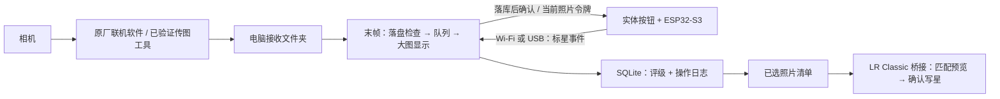

# 末帧 LINK：实体按钮实时选片方案

交付日期：2026-10-17。适用范围：Windows 电脑 + Lightroom Classic。当前交付为设计方案与流程模拟，**不是已完成的硬件驱动或固件**。

## 1. 推荐方案

使用一块 **ESP32-S3 开发板 + 一个实体按钮 + 状态指示灯**，通过 Wi-Fi 或 USB 把“给当前照片设为 1 星”的指令发送给电脑。ESP32-S3 已集成 Wi-Fi，不需要额外 Wi-Fi 模块；可选带原生 USB、充电管理和电池接口的开发板做无线手柄。

相机仍由原厂联机软件、现有传图工具或已验证的相机 SDK 将照片写入电脑指定文件夹。“末帧”监听该文件夹，文件写完后索引、显示并接收按钮评级。拍摄结束，把选中清单交给现有 LR 桥接，或复制已选原片到独立目录后导入 LR。

**按钮只传指令，照片从相机直接到电脑。** USB/无线是按钮的连接方式；相机传图可以另用 USB、网线或相机支持的无线方式，不要求与按钮相同。这里把“无限发射”理解为“无线发射”，不承诺无限距离。



## 2. 现场怎么用

1. 相机连接电脑，设置相机传图软件将原片保存到固定目录，例如 `D:\Shoot\2026-10-17\Look01`。相机本身的存卡策略由摄影师设置，不由按钮控制。
2. 在末帧中选择接收目录，开启“现场接片”，选择 RAW/JPG 配对和默认 1 星。
3. 按钮插入 USB，或通过现场路由器与电脑处于同一局域网。首次配对后，电脑显示设备名、连接方式和就绪状态。
4. 拍一张，电脑显示一张；看屏幕满意时按按钮。电脑先保存星级，再向按钮回传确认，灯闪绿/可选短震反馈。
5. 不满意不按；需要改正时在电脑点“撤销”。短按不会切换或清除星级，重复按也不会把选中取消。
6. 拍完检查“已选”，确认数量后导出或发送 LR。LR 中按星级 ≥ 1 筛选，再进入编辑。

按钮不是快门遥控器，也不负责把照片传入相机或电脑。第一阶段保留一个按钮，只做标星，避免双击/长按的判定延迟。第二阶段可加“上一张”“下一张”按钮或脚踏开关。

## 3. 连拍与过片规则

推荐默认“顺序审片”：按到达的有效照片加入队列，RAW/JPG 同一拍摄编号合并；当前停留照片由摄影师审核，点“下一张”前进。零散单拍时，队列已看完，下一张到达可自动显示。

另提供“自动过片”：每张显示至少约 1.5 秒（可配置）后前进，队列不丢片。暂停后保持当前照片，新的文件只进队列。按钮始终标记屏幕当前照片，**不标记最新落盘文件，也不根据拍摄时间倒推**。演示中的自动过片用于展示此规则。

拍摄速度超过审片速度时，队列会积压，界面显示待看数量；不能承诺高速连拍时每张都被人眼看清。要快速跟随最新照片，可另设“跟随最新”模式，但必须记录跳过的未审照片并允许回看，不作为第一阶段默认。

## 4. 硬件清单与接线

以下为小批量原型的人民币预算估算，未询价，不含相机、电脑、工时和认证。

| 部件 | 建议 | 参考预算 |
| --- | --- | --- |
| 主控 | ESP32-S3，明确带原生 USB 接口的开发板 | ¥25–65 |
| 按钮 | 瞬时常开按钮，大帽/静音款优先 | ¥5–20 |
| 指示灯 | 普通 LED + 限流电阻，或使用板载灯 | ¥1–8 |
| USB 线 | 支持数据传输，USB-C 接口按开发板选 | ¥8–20 |
| 外壳与固定 | 3D 打印外壳、手持/桌面防滑、线材 | ¥20–60 |
| 无线供电（可选） | 受保护锂电池 + 合适的充电/稳压模块；或成品充电宝 | ¥25–60 |
| 震动反馈（可选） | 马达 + 驱动晶体管/模块，不能直接 GPIO 驱动 | ¥5–15 |

USB 基础样机约 **¥60–175**；无线电池样机约 **¥85–235**。无线续航需按实际板卡、电池、Wi-Fi 重连和休眠策略测量，当前不估算使用小时数。

示例接线须按最终开发板原理图复核：

| 信号 | 示例连接 | 说明 |
| --- | --- | --- |
| 按钮 | GPIO4 ↔ 常开按钮 ↔ GND | `INPUT_PULLUP`，按下为低；软件稳定消抖约 25–40ms |
| 普通 LED | GPIO5 → 330Ω → LED → GND | 电阻按 LED/目标电流复核；不同开发板可调整 GPIO |
| USB | 使用开发板原生 USB 数据口 | ESP32-S3 USB D−/D+ 通常为 GPIO19/20，留给 USB，不接按钮 |
| 电源 | 开发板规定的 USB/电池输入 | GPIO 使用 3.3V；电池不能直接接 GPIO 或随意接 3V3 |

原型避免选用启动绑带脚、Flash/PSRAM 占用脚。部分开发板 USB-C 只连接 USB 转串口芯片，不能因为插口为 USB-C 就认为支持原生 USB HID；采购前检查原理图与端口标识。

## 5. USB 与无线怎么选

| 方式 | 优点 | 边界与建议 |
| --- | --- | --- |
| USB CDC 串口 | 不依赖 Wi-Fi；双向协议和 ACK 清晰；单线供电 | 推荐最先实现；按设备 VID/PID/序列号识别端口，处理拔插和 COM 号变化 |
| Wi-Fi TCP 长连接 | 摄影师可拿着按钮移动；与 USB 共用事件语义 | 推荐正式无线方式；局域网延迟和覆盖受现场环境影响，需心跳/重连 |
| USB HID 键盘 | 快速验证“按一下能标星” | 普通快捷键依赖前台焦点，容易作用于其他窗口；仅作为台架验证，不作为正式通道 |
| BLE / 专用 2.4GHz | 后续可评估 | BLE 配对/系统栈需单独验证；ESP-NOW 需要电脑侧接收器，第一版不采用 |

Wi-Fi 首选已有的现场路由器。无路由器时可评估电脑热点，但须实测热点关闭、休眠与防火墙行为；不能假定设备热点和电脑相机无线网络可同时工作。只有按钮网关对局域网开放，现有照片服务和 LR 桥接保持 `127.0.0.1`，不把整个工作台直接暴露到 Wi-Fi。

## 6. 为什么不会标错图

不能只发一个没有对象的 `STAR`，否则网络稍慢、电脑恰好切到下一张，就可能写错。建议为每次**真正显示完成**的照片生成一次性 `view_token`。

1. 大图解码、绘制完成且窗口可见后，电脑发送 `ARM(session_id, capture_id, view_token)`。同一照片重新打开也换新令牌。
2. 按钮确认 ARM 后显示就绪；电脑也显示“按钮就绪”。切图、断线、窗口隐藏/最小化或切换项目会使旧令牌失效。切图期间短暂不可用。
3. 按下时，设备锁存已收到的照片 ID 和令牌，并生成事件 ID；不在重试时改成新的照片。
4. 电脑校验当前会话/照片/令牌、连接与有效期，合格后把事件与星级在**同一个数据库事务**中保存，再返回 `ACK: committed`。
5. 数据库保存失败、没有可显示照片、令牌过期或界面不在可审核状态，都拒绝写星，并返回明确原因。

无线有传输时间，无法仅靠一个没有同步时钟的按钮完全证明“物理按下的瞬间屏幕是哪张”。本方案选择**有歧义就拒绝，提示回看并再按**，而不是猜测目标。若按下后切图、指令延迟才到达，旧事件会拒绝；刚切图尚未完成重新 ARM 时也不能标星。需要更低漏记率时，可延长停留时间、暂停审片或用 USB。

同一事件重发只返回已保存结果，不重复改变评级；重发成功事件后，即使用户已撤销，也不能重新打星。USB 与 Wi-Fi 同时可用时，同一事件 ID 共用去重账本，默认一个主通道，另一个只用于故障切换，防止双发。切换通道后重新 ARM。

### 协议草案（尚未实现）

开发期可采用 UTF-8 JSON 行协议；限制行长例如 2KB，校验协议版本、字段类型、动作白名单与消息速率。USB CDC 与 Wi-Fi 使用同一消息体。

```json
{"v":1,"type":"rate","device_id":"button-01","boot_id":"b62f...","seq":42,"event_id":"button-01:b62f...:42","session_id":"shoot-01","capture_id":"cap-108","view_token":"view-random-token","action":"set_rating","value":1}
```

```json
{"v":1,"type":"ack","event_id":"button-01:b62f...:42","status":"committed","capture_id":"cap-108","rating":1}
```

`boot_id` 每次启动随机生成，`seq` 本次启动递增，避免重启后重复编号。新事件还须绑定短期就绪租约，例如设备端 3 秒内未收到续租就停止接受按键；租约以设备本地单调时间计算，不依赖电脑/设备墙钟相同。TCP 不等于已落库，仍需应用级 ACK。

ACK 超时仅在同一连接、同一令牌有效期内有限重试；过期、断线、重启或重新配对后不回放未确认按键，也不套用到新照片。重连时可查询旧事件处理状态，恢复反馈但不重新执行业务。未知状态提示用户核对电脑星级。

Wi-Fi 使用物理确认的首次配对与随机设备密钥，凭据经 USB 配置或经确认的配网流程建立；正常连接需要认证，消息防篡改/防重放，可采用经验证的 TLS 通道。令牌不能代替设备认证。日志不保存 Wi-Fi 密码。未配对设备不能修改星级。

灯光：未连接慢闪；已连接未就绪黄灯；可按时常亮；收到落库 ACK 短闪绿；拒绝/超时黄闪或震动。LED 表示连接/处理状态，不能代替电脑上的星级与目标照片显示。

## 7. 电脑端怎么扩展现有项目

当前项目已具备：Tauri 桌面窗口、Python 本机引擎、SQLite 评级、RAW/JPG 配对、EXIF/RAW 预览、正式清单和 LR Classic 桥接。**实时目录监听、设备网关与固件尚未开发。**

建议新模块与既有职责：

| 层 | 设计职责 | 接入点 |
| --- | --- | --- |
| 实时接片 | Windows 目录事件 + 周期补扫、稳定性检查、增量入库 | 新增 `选片助手/live_ingest.py`（拟）并接入 `media_engine.py` |
| 当前显示状态 | 只在图像成功显示后提交新令牌；切图/隐藏时失效；队列/暂停 | `演示方案/app.js`、`formal.js`；Tauri 窗口可见性通知 |
| 按钮网关 | USB CDC / Wi-Fi、配对、ACK、重连、限流 | 新增 `选片助手/button_gateway.py`（拟）；独立 LAN 监听，不复用公开工作台端口 |
| 原子评级 | 事件唯一约束、人工评级、事务与操作日志、撤销保护 | `选片助手/catalog_store.py`；检查既有会话 revision 冲突 |
| LR 交接 | 沿用正式 schema/version、路径匹配、确认与结果回传 | `FramekeepBridge.lrplugin/`，不直接修改 `.lrcat` |
| 固件 | GPIO 消抖、锁存照片令牌、认证、通道切换、状态灯 | 新增 `硬件固件/`（拟），建议 ESP-IDF/TinyUSB/CDC |

文件“出现”不代表传输完毕：忽略临时扩展名；对大小/修改时间做多次间隔检查（例如 500ms × 2，参数需现场验证），再尝试元数据/预览解码；失败退避重试并报告，不能仅凭两次大小一致认定成功。监听溢出、网络盘断线后周期补扫，路径/文件身份去重。文件随后又增长则使缓存失效并重新检查。

RAW/JPG 配对以会话/相机来源/路径/拍摄编号等联合判定，不能只用文件名；JPG 先到可先显示，RAW 后到补到同一记录、保留已有星级。多机同名文件分子目录，避免磁盘覆盖；两个来源无法唯一判定时进入待复核。临时文件重命名和同路径重传须保留文件身份/内容变更记录。

缩略图缓存、全 RAW 解码和 AI 任务不能堵住接片/评级队列；第一阶段不自动调用 AI、不产生模型费用。收片中的目录会改变快照，需要采用增量合并保存人工评级，不能用全量重扫覆盖当前状态。发送 LR 时固定一个导出快照，后续新照片或新星级属于下一次同步。

## 8. 交给 Lightroom 的三条路径

### A. 已在 LR 的照片：推荐使用现有桥接

末帧导出正式 `schema: framekeep.selection`、`version: 2`、`demo: false` 清单，仅含选中照片；沿用原有 `source`、`relativePaths` 与 `applyPolicy`。LR 不能原生读这种 JSON，必须通过现有插件导入/连接。

1. 确保原片已导入 **Lightroom Classic**，或先导入原片。
2. 末帧“发送 LR” → 桥接匹配已导入记录 → 核对数量、路径和冲突 → 确认写星。
3. 原有 2–5 星默认保护；未列出的照片不清零；RAW/JPG 作为一个主记录时去重。
4. LR 按 ≥ 1 星筛选编辑。当前桥接已有本机真实单张写星成功记录，不能据此认为此硬件链路或大批同步已验证。

LR Classic“自动导入”是否适合当前传图方式需另测：它可能移动监控目录中的文件，不能与末帧同时按原路径监控并假定路径不变。第一阶段使用稳定落盘目录，拍摄后导入；若使用 LR 原生联机拍摄，须验证最终落盘路径与目录记录何时可匹配。

### B. 只想把选中的原片带进 LR：选中原片复制出口（待开发）

“复制已选原片”将 RAW 与可选 JPG **复制**到新目录，保留相对子目录、不覆盖同名文件，校验数量/大小与可选哈希，失败列出清单；源目录不移动、不删除。再导入 LR，并用正式桥接按明确的导出路径映射写星。仅复制文件本身不会自动携带本地 SQLite 的星级。

输出目录选在监听目录外，避免被当作新照片递归收片；已在 LR 中导入的原片优先用 A，减少重复目录记录。这一复制出口在当前项目中尚未实现。

### C. XMP：后续备选

相机 RAW 可考虑写入合并后的 XMP 侧车，但必须保护原有编辑/元数据；JPEG/DNG 等另有内嵌元数据规则。已导入 LR 的照片还可能需要读取元数据并处理冲突。第一阶段不写源文件、不生成覆盖式 XMP，不把它当作通用零配置评级交换方式。本方案未验证 Lightroom 云端版。

## 9. 演示怎么操作

双击同目录 `index.html`，或运行根目录 `启动硬件选片演示.cmd`。无需安装依赖，不连接相机/按钮，不读用户照片，不写正式数据库。画面均为程序绘制的示意图。

1. 点“模拟拍摄 +1”，待按钮显示就绪，按右侧实体按钮示意；当前照片出现 1 星，日志显示保存与 ACK。
2. 选 USB / Wi-Fi，观察两种通道走相同选片逻辑。
3. 点“重发上一事件”，验证去重；再次按实体按钮也保持 1 星，不切换取消。
4. Wi-Fi 设置“900ms 延迟”，按按钮后立即点“下一张”；旧事件会拒绝，不标到新照片。
5. 断开连接，尝试标星；恢复后重新就绪，旧事件不会补到新照片。
6. 点“撤销”，再重发旧成功事件，星级保持撤销后的状态；点“下载模拟清单”，检查所选照片与数量一致。

演示清单采用独立 `schema: framekeep.hardware-demo`、`demo: true`，不是正式 LR 输入。延迟、连接、接片、评级落库和 ACK 全部为内存状态模拟；刷新页面重置。正式版需实现上述原子数据库事务和设备认证。

## 10. 实施阶段与样机验收

| 阶段 | 具体产出 | 粗略工期估算 |
| --- | --- | --- |
| 台架样机 | ESP32-S3 + 按钮，USB CDC 协议、消抖、就绪灯、基本 ACK | 1–2 工作日 |
| 实时接片 | 增量监听、完整性检查、RAW/JPG 补全、显示队列、令牌与评级事务 | 3–5 工作日 |
| 无线样机 | 配网/认证、双向连接、断线/重连、去重与故障切换 | 2–4 工作日 |
| 现场联调 | 指定相机/传图软件、LR 流程、弱网、重启、供电与外壳 | 2–4 工作日 |

合计约 **8–15 工作日**，是复用现有项目的开发估算，未包含采购等待、量产 PCB、认证与未知相机 SDK 难题。建议先做 USB，再加 Wi-Fi；两者共用协议，不分叉评级逻辑。

以下为**验收目标，尚未实测**：

- 指定相机真实传图 ≥ 200 个拍摄编号；单拍、连拍、RAW-only、RAW+JPG、写入中断、JPG 先到/RAW 后到均纳入。记录拍摄到落盘、落盘稳定到显示、按键到落库 ACK 的独立时间，不用按钮延迟冒充总传图延迟。
- 就绪后按键到 ACK：USB 目标 P95 ≤ 150ms、稳定局域网 Wi-Fi 目标 P95 ≤ 250ms，含消抖；以设备单调时钟测完整往返。记录样本量、失败率和 P99，不把超时从报告中隐藏。
- 交错切图/迟到事件、1000 次按键/抖动/重发、切通道、设备重启：测试集内零错图、零重复业务写入；过期事件明确拒绝并可回看，不能据此宣称所有环境绝不会出错。
- 断网、拔 USB、电脑休眠、程序退出/恢复、SQLite 写入失败：未确认不得亮成功灯，重连不回放旧按键，已保存评级可恢复。
- LR 用至少 20 个已知选中编号核对：RAW/JPG、已有高星、路径变更、同名冲突、缺失和撤销；期望匹配集合/星级逐项一致，再扩大规模。

进入硬件实施前需确认相机型号、当前传图软件、电脑接口、期望单拍/连拍节奏、无线活动距离和是否必须电池供电；这些信息不阻碍当前方案演示，但决定最终器件与兼容验收范围。
